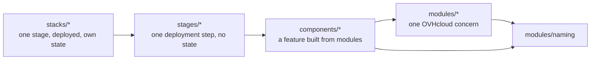

---
references:
  - path: tools/internal/stacks/stages.go
    blob: 33eb518d978ed33b6ae3b0c79b1247813638565c
  - path: tools/internal/checks/dependencies.go
    blob: 793040e8a2f7c2e9d569428fbfe1788c79683a13
  - path: tools/internal/live/credentials.go
    blob: aa7dae28c6bf99f8ac61902b4888161f16e24e2f
  - path: stacks/deployments.yaml
    blob: a4e4c7b24494733e88b0fb9e4d3baa3fa8b2d132
  - path: stacks/_lz/backend.tm.hcl
    blob: e622f7854ef111f266927b7dae6fc927794de7da
  - path: tools/harness/capabilities.yaml
    blob: ecbfcfbec8dac380494d8b930e40205e6113a05b
  - path: tools/cmd/lz-offline/main.go
    blob: 1561dacadcec35f3bee515d7cc26363f4509ef4c
  - path: tools/internal/live/guard.go
    blob: 06380923b8f393674f1d00adec3533ddac3bebc1
last_verified: 71c2de81d7bfd86776df728dc5ae87976e26836b
---

# Architecture overview

The landing zone is OpenTofu code in four layers. Reusable code sits in three of them; the fourth,
`stacks/`, holds the deployed copies, each with its own state. Every check runs offline first; only
the maintainer applies to a real account. This page describes the first slice as built
([spec 005](../../specs/005-first-landing-zone-slice/spec.md)). The ADRs linked below say why.
Unfamiliar terms are in the [glossary](../reference/glossary.md).

## Four layers

An arrow means "may call". Nothing calls upwards, and nothing skips a layer.

| Layer | Holds | May | May not |
| --- | --- | --- | --- |
| `modules/` | Thin wrappers over one OVHcloud product concern (a project, a bucket, an IAM policy), plus the pure `naming` module. | Declare resources; call `modules/naming`. | Call other modules; configure a provider or a backend. |
| `components/` | Landing-zone features composed of modules. Families with variants (`identity/ovh-native`, `network/island`, `runtime/managed-only`) or singletons (`state-backend`, `project-factory`). | Call modules and `modules/naming`. | Call another component or a stage; configure a provider or a backend. |
| `stages/` | One reusable module per deployment step. | Call **one** component, once. | Declare resources itself; hold a backend or provider credentials. |
| `stacks/` | One generated directory per row of `stacks/deployments.yaml`, calling one stage. | Hold the backend, the provider block and the state. | Contain hand-written `.tf` files (the `_lz_*` files are generated); read another stack's state. |

`lz-check deps` enforces most of this table: who may call whom (`LAYER_VIOLATION`), no backend or
provider below `stacks/` (`LIBRARY_BACKEND`, `LIBRARY_PROVIDER_CONFIG`), no resource in a stage
(`STAGE_RESOURCE`), no hand-written stack file (`HANDWRITTEN_INSTANCE`) and no state reads
(`REMOTE_STATE`). The one-component rule is checked for five stages (`STAGE_COMPONENT_CALLS`: only
their named component, at most once); `bootstrap` follows it by convention, unchecked. Why layers at all: [ADR-0002](../adr/0002-repository-structure.md) and
[ADR-0003](../adr/0003-layered-taxonomy-and-module-naming.md). Why one state per stack and outputs
as files: [ADR-0004](../adr/0004-staged-roots-and-output-contracts.md).

Stacks never read each other's state. After an apply, a stack publishes an `outputs.json`
envelope, checked against `schemas/outputs/`; a stack that needs those values reads only that file.

## Stages, their order and who applies them

The stage table is fixed in code (`tools/internal/stacks/stages.go`). Each stage runs under one
authority (its *principal*), and the live lane gives a stack only that authority's credentials.

| Stage | One stack per | Runs after | Applied by | Live chain |
| --- | --- | --- | --- | --- |
| `bootstrap` | account | — | bootstrap | retained |
| `tenant-state` | tenant | `bootstrap` | bootstrap | retained |
| `account-governance` | account | `bootstrap` | bootstrap | retained |
| `project` | tenant × environment | `account-governance`, `tenant-state` | platform | retained |
| `project-network` | tenant × environment × region | `project` (+ the two above) | tenant | ephemeral |
| `runtime` | tenant × environment × region (+ slot) | `project` (+ the two above) | tenant | ephemeral |

So the order is bootstrap → tenant-state and account-governance → project → project-network and
runtime. `runtime` does not wait for `project-network`: the managed-only runtime has no network.
`account-admin`, `account-fabric` and `observability` are reserved names; a manifest row naming one
is refused.

The three authorities:

- **bootstrap** — the account's admin service account. It is created by the bootstrap script
  (`task bootstrap:account`), not by a stack, because no stack can run as a principal it must
  first create.
- **platform** — a deployer client that `account-governance` creates. It applies `project`.
- **tenant** — one deployer client per tenant, also created by `account-governance`, with a
  narrow allow-list. It applies `project-network` and `runtime`.

A live chain applies stacks in this order. On exit it destroys the *ephemeral* ones in reverse
order and keeps the *retained* ones (state buckets, identities, the project). Why the identities
are split this way: [ADR-0009](../adr/0009-state-backend-bootstrap-and-credentials.md) (credential
matrix) and [ADR-0018](../adr/0018-identity-planes-roles-and-providers.md).

## What runs offline and what runs on the host

| Where | What | Credentials |
| --- | --- | --- |
| **Offline entry** (`lz-offline`) | Every check CI runs: lint and unit tests (`task test:slice`), stack freshness (`task stacks:check`), mocked plans of every stack (`task test:stack-plans`), the output exchange (`task test:exchange`), docs and spec traceability. | None. No network. |
| **Host, any checkout** | `task stacks:reconcile` and `task stacks:generate`: turn an edited `stacks/deployments.yaml` into stack directories. | None; no cloud call. |
| **Host, maintainer only** (`lz-live`) | `task bootstrap:account` and the `live:*` targets: probes, plan, apply, destroy and the chain against a real account. | The selected authority's, from files outside the repository. |

`lz-offline` is installed from a digest-pinned build outside the clone. It takes a read-only
snapshot of the checkout (the *candidate*), copies it into a private scratch directory and runs
the checks there, with the pinned toolchain, a provider mirror and no network
(`tools/harness/capabilities.yaml`). The snapshot holds only a fixed list of root entries: the
Taskfile and tool configuration, `.github`, `pipelines`, `tools`, `tests`, `specs`, `docs`,
`schemas`, the module, component, stage and stack trees, `README.md` with the `LICENSE` and
`NOTICE` it links, `AGENTS.md`, `mise.live.toml` and `.specify`. At every level it leaves out
`.git`, `.local`, `.terraform`, `.cache`, `.env`, `.env.*` and `.envrc`, refuses links, and
gives each target one 240 s deadline. The checkout itself is never written. `lz-live` refuses to
run inside the offline entry, from a linked worktree, on a dirty tree, or at a commit other than
the reviewed one on `origin/main`. Today it
runs from the maintainer's workstation rather than a protected pipeline (known deviation KD-2 in
the [spec](../../specs/005-first-landing-zone-slice/spec.md#known-deviations)). Why:
[ADR-0007](../adr/0007-pipeline-portability.md) (task contract, Terramate),
[ADR-0008](../adr/0008-testing-strategy.md) (test layers) and
[ADR-0019](../adr/0019-agent-experience-sensors-and-guides.md) (sensors and the trust boundary).
The maintainer's procedure is the [runbook](../how-to/run-the-first-slice.md).

## Where state lives

- **`bootstrap`**: local state, outside the repository, in the maintainer's per-account
  configuration directory. It creates the account state bucket, so it cannot keep its state there.
- **Account-level stacks** (`tenant-state`, `account-governance`): the account state bucket.
- **Tenant stacks** (`project`, `project-network`, `runtime`): one state bucket per tenant, created
  by that tenant's `tenant-state` stack.
- **State key**: the stack's path without `stacks/`, plus `/terraform.tfstate`
  (for example `tenants/demo/dev/project/terraform.tfstate`).
- **Locking and encryption**: every S3 backend sets `use_lockfile = true`; every state and plan,
  local or remote, is encrypted client-side with a passphrase-derived key (generated from
  `stacks/_lz/backend.tm.hcl`).
- **Published outputs**: `artifacts/<instance id>/outputs.json` in the instance's state bucket.
- **Live run records**: `.local/live/<run-id>/`, gitignored.

Two limits are recorded, not hidden. In the sandbox the state buckets share the one Public Cloud
project with tenant resources, so tenant state isolation is not demonstrated (KD-1). The
platform-owned `project` stack keeps its state in the tenant's bucket (KD-3). ADR-0009's KMS key
and escrowed backup are not built yet. Details:
[spec 005, known deviations](../../specs/005-first-landing-zone-slice/spec.md#known-deviations).
